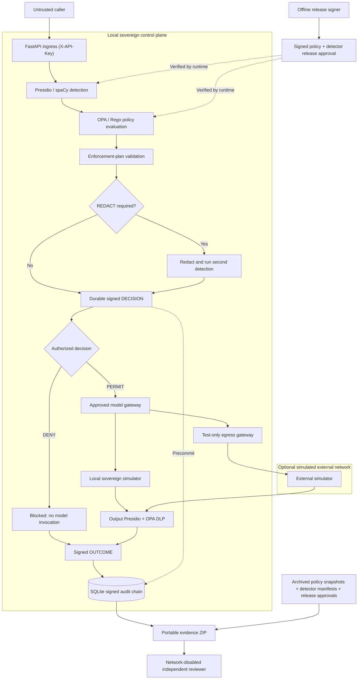

# Sovereign AI Control Plane

A **local security reference implementation** for governing requests to AI models. The control plane detects sensitive input, evaluates versioned OPA/Rego policies, enforces approved routing and redaction, inspects model responses before releasing them, and records independently checkable evidence.

**Source implementation: API version 0.6.0, M6 signed releases, M7 operational features and response-side DLP.** M1-M6 functionality has been exercised on Windows with Podman Compose; the Milestone 6 operator verification reported `RELEASE_VERIFIED`, 14/14 Rego tests, signed request evidence, and successful disconnected policy replay. M7 adds bounded concurrency, durable opt-in idempotency, diagnostics, upload deadlines, serialized release publication, and profiling tools. These implemented features do not establish completion of the M7 performance acceptance criteria. This is a **single-host prototype**, not a certified compliant or production multi-tenant platform.

Response-side DLP is implemented in source, including **operator-disabled-by-default v5 output masking** and detector refinements. Earlier operator reports describe v4 approval, but the **tracked generation-7 approval is a historical v3 example** and is not the host's live release. Source changes require a separately reviewed and signed successor approval to activate. See [release status](docs/release-status.md) and [response-side DLP](docs/response-side-dlp.md).

## Capabilities at a glance

| Area | Implemented now | Important boundary |
| --- | --- | --- |
| Ingress | FastAPI `POST /v1/prompts`, API-key authentication, size limits, sanitized errors | One fixed local principal/tenant, not OIDC/RBAC |
| Request lifecycle | Durable opt-in idempotency, status lookup, bounded admission and worker queues | No automatic recovery, cached output or exactly-once inference |
| Diagnostics | Authenticated process-local concurrency metrics and profiling tools | Rolling samples; no global monitoring or proven capacity guarantee |
| Detection | Local Presidio/spaCy, custom recognizers, deterministic normalized findings, coverage and `UNKNOWN` | Best-effort English ASCII scope; false negatives remain possible |
| Policy | Direct OPA/Rego with default deny; content-addressed archived policy snapshots | Rego inputs are structured detection metadata, not raw prompt text |
| Enforcement | `PERMIT`/`DENY`, ordered `REDACT` then `ROUTE`, post-redaction rescan, destination registry | External route is **test-only simulator**, disabled by default |
| Response DLP (v5 source; runtime depends on approval) | Inspect generated responses locally, enforce OPA output allow/block, sign audit outcome before release; v5 can selectively mask email/phone | Source or passing tests do not prove installed signed approval; best-effort classification |
| Audit | SQLite WAL, signed SHA-256 event chain, decision committed before model invocation, separate outcome events | Keys live on the local host; a lost outcome can remain unresolved |
| Provenance | Detector model/source manifest, exact policy digest and archived replay | Artifact identity does not prove classifier correctness |
| Releases | Separate Ed25519 release approval for policy/detector identities, activation generation and predecessor | Local generation checks are not hardware-backed anti-rollback |
| Evidence | Portable ZIP; offline audit verification and OPA replay; optional independent public-key/checkpoint anchors | Without external audit key/checkpoint, history is self-consistent but not independently complete |

## System overview



The default Compose network is private. The API binds to `127.0.0.1:8000`; OPA and model ports are not published. The optional `egress-test` profile creates a separate simulated network. **Neither a Compose network nor a policy label establishes real-world data residency.**

## Protect live signed state from Git checkouts

**Host-side live policy, release, trust and archive files now live in the
Git-ignored `.runtime/` directory, not the Git-tracked legacy examples.**
This prevents a `git pull` or GitHub Desktop checkout from rolling back the
live release or changing its policy bytes. Container bind mounts reject
missing state directories rather than silently creating empty ones.

**Existing deployments must migrate before using the updated Compose mounts.**
Do not run `git clean -fdx` or delete the checkout without backing up
`.runtime`. For the verified, copy-only migration, operator preflight,
new-install instructions and follow-on release workflow see
[Git-safe operator state migration](docs/operator-state-migration.md).
The running image can remain approved across this host-only migration; no
new signature or generation is needed simply to move the bind sources.

## Fresh reviewer install from published GHCR images

For a **new, isolated Windows/Podman reviewer machine**, use
[the signed-image submission bootstrap](docs/submission-bootstrap.md). Once
the submission includes a reviewed `deploy/submission-lock.json` pinning an
actual published release and its independently trusted checksums, the reviewer
can run `.\bootstrap.ps1` from the checkout root. This pulls immutable OCI
images and verifies release/detector identity; it **does not rebuild or sign**
the application. By default it starts five containers including the isolated
external simulator and egress gateway; use `.\bootstrap.ps1 -SovereignOnly`
for the three-container mode. Import the [Postman demo](deploy/postman/sovereign-demo.postman_collection.json)
and [environment](deploy/postman/sovereign-local.postman_environment.json) for seven
synthetic scenarios with paired audit lookups. The bootstrap refuses existing `.env` or `.runtime` state.

The source-build path below remains appropriate for a fresh independently
signed developer environment or an **existing** signed-release installation.
Do not use the submission bootstrap as an upgrade/migration command.

## Start an existing signed-release installation

Requirements: Windows PowerShell, Python 3.12+, Podman + Compose provider, and enough resources for local spaCy. Building the detector image requires network access to install dependencies and the pinned `en_core_web_sm` model; request processing does not download the model.

**Keep `.env`, `.runtime/`, the `audit-data` volume and the existing release signing key.** The legacy example `release-active/` files in Git are not a substitute for possession of the corresponding trusted private key. For a brand-new independent installation, provision an appropriate release authority and initialize a clean deployment history instead of attempting to sign over another authority's previously active approval.

~~~powershell
# From the repository root, with .env and a trusted release key already provisioned:
python -m pip install "cryptography>=50.0.2,<51"
python -m tools.verify_policy_snapshot
python -m tools.verify_release

# If a new release is necessary, use the EXISTING signer and sign an N+1 approval.
# Stop services before changing active release artifacts.
# This rebuilds the intended image before signing:
podman compose -f deploy/compose.yaml --env-file .env stop opa control-plane
.\Approve-And-ActivateRelease.ps1 -UseExistingKey

# Run the EXACT approved image. Do not rebuild after signing:
podman compose -f deploy/compose.yaml --env-file .env up --no-build --force-recreate -d
Invoke-RestMethod http://127.0.0.1:8000/health/ready -Headers @{"X-API-Key"=$env:CONTROL_PLANE_API_KEY}
.\Verify-SignedReleaseWorkflow.ps1
~~~

For the optional simulated egress test, add `ENABLE_EXTERNAL_SIMULATOR=true` to `.env` and place `--profile egress-test` before `up`. Use **synthetic** inputs only.

**Never run `podman compose down -v`** on a deployment whose audit history or signing keys you need to keep. `down` without `-v` preserves the named volume.

### Developer workflows

Policy identity is bound to exact archived source bytes and authorized by a signed
release. Editing source or restarting OPA alone does not activate an approved
change. Follow [Changing policy or detector code](#changing-policy-or-detector-code)
and the [release workflow](docs/signed-release-workflow.md).

## Python code quality

Install the development tools into your virtual environment:

```powershell
.venv\Scripts\python.exe -m pip install -e ".[dev]"
```

Run the checks from the repository root (no virtual-environment activation needed):

```powershell
make lint          # Ruff: Python errors, unused imports, and import ordering
make format-check  # Verify Ruff formatting without editing files
make typecheck     # mypy: app, simulator, tools, and tests
make check         # All of the above plus pytest
```

Use `make lint-fix` to apply safe lint fixes and `make format` to format code.
Ruff targets Python 3.12 with a 100-character line length. Mypy checks annotated
code and the bodies of unannotated functions; full annotations are not required.
Tool versions are pinned in the `dev` extra so formatting stays consistent.

Without Make, run the equivalent commands directly in PowerShell:

```powershell
.venv\Scripts\python.exe -m ruff check .
.venv\Scripts\python.exe -m ruff format --check .
.venv\Scripts\python.exe -m mypy
.venv\Scripts\python.exe -m pytest -q
```

On Linux/macOS, use `.venv/bin/python` instead. For direct fixes, use
`python -m ruff check --fix .` and `python -m ruff format .` with your
virtual environment active.

Classifier source bytes are part of the detector manifest. After formatting or
editing them, rebuild the image and approve a new release using the existing
Milestone 6 workflow before deploying it.

## Regression tests
~~~powershell
python -m pip install -e '.[dev]'
python -m pytest -q
podman compose -f deploy/compose.yaml --env-file .env exec control-plane python -m tools.smoke_detection
podman compose -f deploy/compose.yaml --env-file .env run --rm opa test /policies /policy-tests
~~~

A `Makefile` also provides `make test`, `make smoke`, `make test-policy` and other conveniences (requires Make). `make up` and `make restart` verify the image against the mounted signed release and start with `--no-build`. `make build` remains a separate operation; approve its resulting detector identity before starting it.

If startup reports `Installed detector identity is not approved`, the rebuilt image differs from the active approval. For an intended change, approve that existing image with `.\Approve-And-ActivateRelease.ps1 -UseExistingKey -SkipBuild -Python .\.venv\Scripts\python.exe`, then run `make up` and `make check-containers`. Omitting `-SkipBuild` builds the image before approval. The helper signs a successor generation with the existing key and preserves release archives.

### API smoke test (PowerShell)

~~~powershell
$key = (Get-Content .env | Select-String '^CONTROL_PLANE_API_KEY=').ToString().Split('=',2)[1]
$body = @{prompt='Explain local policy evaluation';destination_id='sovereign-model';purpose='GENERAL'} | ConvertTo-Json
Invoke-RestMethod -Uri http://127.0.0.1:8000/v1/prompts -Method POST -Headers @{'X-API-Key'=$key} -ContentType 'application/json; charset=utf-8' -Body ([Text.Encoding]::UTF8.GetBytes($body)) | ConvertTo-Json -Depth 10
~~~

On an approved local request, expect `COMPLETED`, a `PERMIT` decision, and signed decision/outcome receipts. A private-key marker should be blocked; unsupported non-ASCII text is classified `UNKNOWN` and denied. `GET /v1/requests/{request_id}` returns tenant-scoped signed evidence metadata (not the raw prompt). API docs: `http://127.0.0.1:8000/docs`.

Requests may include an `Idempotency-Key` header. A matching retry returns HTTP 409
with the original request ID; a conflicting payload returns HTTP 409 without it.
`GET /v1/idempotency/status` accepts the same API key and idempotency key in headers.
It reports recorded lifecycle state without recovering the original output or
retrying inference. See [idempotency and reconciliation](docs/idempotency-and-request-lifecycle.md).

`GET /v1/diagnostics/concurrency` requires `X-API-Key`. Prompt admission can return
429, ingress saturation can return 503, and an expired upload deadline returns
408. See [configuration](docs/configuration.md) for limits and defaults.

## Changing policy or detector code

Editing `policies/decision.rego` **does not activate** a new policy. The current deployment requires a content-addressed policy snapshot and a **newly signed release** approving the exact policy and installed detector digests.

1. Review the proposed policy and run tests. Stop OPA and control-plane before changing active artifacts (`podman compose -f deploy/compose.yaml --env-file .env stop opa control-plane`); build and verify the snapshot with `python -m tools.build_policy_snapshot` and `python -m tools.verify_policy_snapshot`.
2. Build the intended detector image and obtain the installed artifact digest.
3. Use the existing out-of-runtime private signing key to sign a new generation (predecessor must match the currently active release), then run `tools.activate_release` / `tools.verify_release`. The operator helper `Approve-And-ActivateRelease.ps1 -UseExistingKey` covers the normal next-generation workflow.
4. If the Rego revision changed, update `EXPECTED_POLICY_REVISION` in `.env`.
5. Recreate **OPA and control-plane** with the approved image, without rebuilding; run `Verify-SignedReleaseWorkflow.ps1`.

A rollback to older policy bytes is **a new signed generation**, not reactivation of an earlier approval. Retain every policy/release archive needed for replay. See [Milestone 6](docs/signed-release-workflow.md).

## Evidence and trust

The exporter (`python -m tools.export_evidence_package --out /var/lib/sovereign/evidence.zip` inside the control plane) packages a consistent read-only SQLite snapshot, audit public key, relevant Rego snapshots, detector manifests and signed release approvals. `Verify-SignedReleaseWorkflow.ps1` tests export and verification in a **network-disabled** reviewer.

A result of `EVIDENCE_PACKAGE_SELF_CONSISTENT` with `REPLAY_VERIFIED` confirms the package's internal signatures, chain, manifests and eligible policy replays. It does **not** by itself authenticate the audit signing key or establish complete history. A separately provisioned release verification key authenticates release approvals only. Use separately retained `--trusted-public-key` and `--trusted-checkpoint` for stronger audit authentication. A checkpoint generated inside the same ZIP is not an independent witness.

The verifier cannot replay original NLP classifications: raw prompts and original model binaries are intentionally absent. Historic M1-M3 events are integrity-only; later events are replayable to the extent supported by their recorded provenance.

## Documentation

Start with the [documentation guide](docs/README.md) for the canonical current operational references, [release-status reconciliation](docs/release-status.md), [reviewer walkthrough](docs/submission-reviewer-guide.md), evaluation guides, historical records, and [submission-readiness audit](docs/submission-documentation-audit.md). Historical milestone instructions are not substitutes for the current signed-release workflow.

- [Current architecture and request lifecycle](docs/architecture.md)
- [Current threat model and sovereignty limitations](docs/threat-model.md)
- [Detection and provenance](docs/detection-design.md)
- [Policy authoring, signing and activation](docs/policy-design.md)
- [Audit integrity, replay and evidence trust](docs/audit-design.md)
- [Testing and release verification](docs/testing.md)
- [Operational logging and privacy](docs/logging.md)
- [Configuration, capacity limits and upload deadlines](docs/configuration.md)
- [Idempotency and request-lifecycle reconciliation](docs/idempotency-and-request-lifecycle.md)
- [Concurrency profiling and acceptance criteria](docs/concurrency-performance-profiling.md)
- [Live overload and audit lookup diagnostics](docs/overload-and-audit-lookup.md)
- [Synthetic detection evaluation](evaluation/README.md)
- [Milestone 3: redaction and simulated egress](docs/history/redaction-and-egress.md)
- [Milestone 4: content-bound Rego](docs/history/policy-snapshots-and-replay.md)
- [Milestone 5: detector provenance](docs/history/detector-provenance-and-evidence.md)
- [Milestone 6: release approvals](docs/signed-release-workflow.md)
- [Architecture decisions (ADRs)](docs/adr)

## Deliberate limitations / next work

This prototype does **not** provide a real external inference provider, evidence of geographic model residency, streaming/attachment DLP, OIDC or multi-tenant RBAC, full detector replay, production key protection, hardware anti-rollback, independent audit witnessing, or distributed audit sequencing. Requests complete within the HTTP lifecycle. Async orchestration uses bounded detector, audit and integrity worker pools; SQLite remains one local audit sequencer. Automatic execution recovery and response caching are not implemented.

The proposed next priorities are **independently witnessed audit checkpoints and externally pinned audit trust anchors**, then a real local inference runtime with stronger egress/workload identity, followed by enterprise governance and operations. These are roadmap items, **not implemented guarantees**. Security and compliance claims must be bounded by the threat model and actual deployment evidence.

See [Configuration](docs/configuration.md) for request limits, timeouts, deployment overrides, and signed detector rules.
