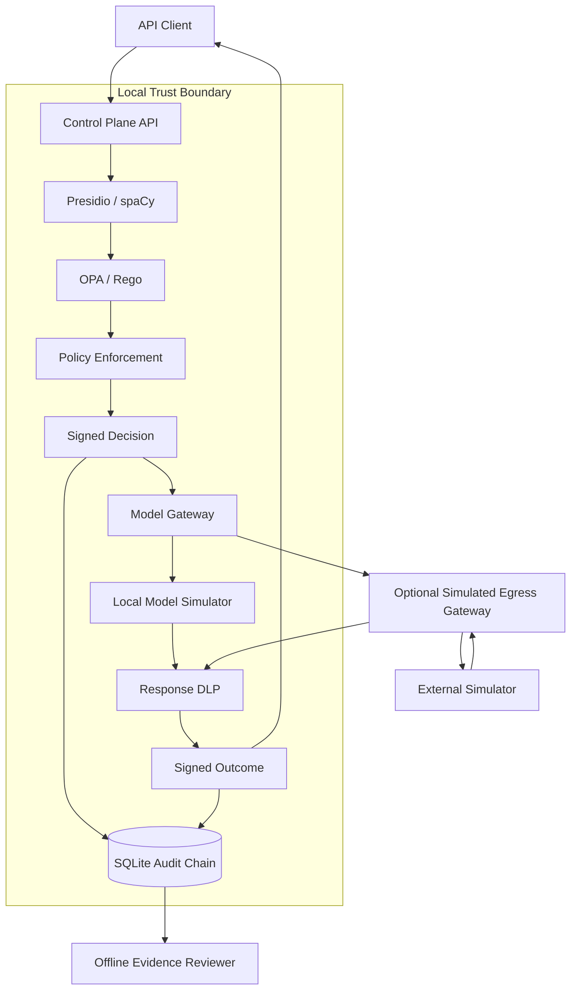

# Sovereign AI Control Plane

A policy-driven security gateway for governing how sensitive data is processed by AI systems.

The control plane inspects incoming prompts, detects sensitive information, evaluates governance policies, enforces approved routing and redaction, inspects model responses before releasing them, and generates cryptographically verifiable evidence of its decisions.

The objective is to demonstrate how an organization can maintain control over sensitive data throughout the AI request lifecycle, independently of the underlying model.

This project is a single-host reference implementation developed for a home assignment. It demonstrates security and governance mechanisms rather than claiming production readiness or regulatory compliance.

## 1. Quick start

### Prerequisites

The reference deployment assumes:

- Windows with PowerShell.
- Git.
- Python 3.12 or newer.
- Podman Desktop with a running Podman machine and a working Compose provider.
- An x86-64-compatible container environment.
- Internet access during installation to download release artifacts and container images.
- Sufficient CPU, memory and disk space for the local NLP detector and containerized services.

No GPU, paid AI subscription or external model-provider API key is required.

### Installation

Clone the repository:

```powershell
git clone https://github.com/IlyaMich/sovereign-ai-control-plane.git
cd sovereign-ai-control-plane
```

Ensure Podman is running:

```powershell
podman machine list
podman machine start
```

If the machine is already running, skip the start command.

From a fresh checkout, run the single installation command:

```powershell
.\bootstrap.ps1
```

The bootstrap script:

- Downloads the pinned published release.
- Verifies release metadata and the trusted signing-key fingerprint.
- Pulls the required container images by immutable digest.
- Verifies the approved policy and detector identities.
- Initializes isolated runtime state.
- Generates a local API key.
- Starts the services and checks authenticated readiness.

The reviewer does not need to build container images manually or possess the release-signing private key.

The exact submitted release is identified by `deploy/submission-lock.json`.

### Accessing the application

| Resource | Address |
|---|---|
| Interactive API documentation | http://127.0.0.1:8000/docs |
| Request processing | POST /v1/prompts |
| Request evidence | GET /v1/requests/{request_id} |
| Readiness | GET /health/ready |
| Concurrency diagnostics | GET /v1/diagnostics/concurrency |
| DLP diagnostics | GET /v1/diagnostics/dlp |

The API is exposed on localhost by default.

### API keys and configuration

The bootstrap generates a local API key and stores it in the Git-ignored `.env` file under:

```dotenv
CONTROL_PLANE_API_KEY=<generated-key>
```

Other important settings include:

| Variable | Purpose |
|---|---|
| API_PORT | Local API port |
| ENABLE_EXTERNAL_SIMULATOR | Enables the optional simulated external route |
| OUTPUT_MASKING_ENABLED | Enables optional response masking |
| MAX_INFLIGHT_REQUESTS | Maximum concurrently admitted prompt requests |
| EXPECTED_POLICY_REVISION | Expected active policy revision |

Do not commit the generated `.env` file or disclose its API key.

See [Configuration](docs/configuration.md) for the complete configuration reference.

### Send your first request

```powershell
$key = (Get-Content .env |
    Select-String '^CONTROL_PLANE_API_KEY='
).ToString().Split('=',2)[1].Trim()

$body = @{
    prompt = 'Explain secure software development'
    destination_id = 'sovereign-model'
    purpose = 'GENERAL'
} | ConvertTo-Json

Invoke-RestMethod `
    -Uri http://127.0.0.1:8000/v1/prompts `
    -Method POST `
    -Headers @{'X-API-Key'=$key} `
    -ContentType 'application/json' `
    -Body $body
```

An accepted request returns its processing status, policy decision, model output and signed audit receipts.

Requests containing prohibited information may be blocked either before model execution or during response inspection.

Use only synthetic data for demonstrations.

### Stopping the application

```powershell
podman compose -p sovereign-review `
    -f deploy/compose.yaml `
    -f deploy/compose.ghcr.yaml `
    --env-file .env down
```

This preserves the audit volume.

Do not use `down -v` unless you explicitly intend to destroy the installation's audit history and associated state.

For alternative deployment options and troubleshooting, see the [Reviewer Bootstrap Guide](docs/submission-bootstrap.md).

## 2. Implemented capabilities

| Capability | Implementation |
|---|---|
| Sensitive-data detection | Local NLP and pattern-based recognizers |
| Policy-based governance | Versioned OPA/Rego policies |
| Input protection | Denial, routing, redaction and post-redaction verification |
| Response protection | Output classification, masking where enabled, and policy-based release or blocking |
| Destination control | Fixed destination registry and optional isolated egress gateway |
| Evidence generation | Signed, hash-linked decision and outcome events |
| Policy and detector integrity | Content-addressed artifacts and signed release approvals |
| Independent verification | Portable evidence export and offline policy replay |
| Operational resilience | Bounded concurrency, request limits, timeouts and opt-in idempotency |
| Observability | Process-local diagnostics, application logging and metrics |

## 3. Architecture overview



The system follows a modular-monolith architecture with separate policy evaluation, model simulation and evidence-review services.

The application evaluates requests before model invocation and inspects generated responses before returning them to clients.

For a detailed explanation of component responsibilities, trust boundaries and security invariants, see [System Design](docs/DESIGN.md).

## 4. Technology and AI choices

| Technology | Reason for selection |
|---|---|
| Python and FastAPI | Rapid implementation, typed API contracts and mature security tooling |
| Microsoft Presidio | Extensible local sensitive-data recognition |
| spaCy and en_core_web_sm 3.8.0 | Lightweight English named-entity recognition without external inference |
| Custom recognizers | Additional coverage for credentials, private keys and other specific sensitive-data formats |
| OPA and Rego | Declarative, testable and independently replayable policy decisions |
| SQLite WAL | Durable local evidence storage with minimal operational dependencies |
| SHA-256, HMAC and Ed25519 | Artifact addressing, privacy-conscious fingerprints and authenticated audit/release evidence |
| Podman Compose | Repeatable, isolated local deployment |
| GitHub Actions and GHCR | Automated checks, container scanning and controlled release publication |

### AI models and providers

Sensitive-data classification uses the locally installed spaCy `en_core_web_sm` model together with Microsoft Presidio recognizers and project-specific detection rules.

The model was selected to avoid sending sensitive prompts to an external detection service, eliminate provider credentials and keep the installation lightweight.

The local and external model endpoints are deterministic simulators. They are used to demonstrate routing, redaction, response inspection and evidence generation without introducing the variability, cost or external dependencies of a real inference provider.

The project does not claim to evaluate the reasoning quality of an LLM or demonstrate actual geographic data residency.

### AI-assisted development

AI-assisted development tools were used throughout the project to support design, implementation, documentation, testing, and troubleshooting.

ChatGPT (OpenAI) was the primary AI assistant, used for architectural discussions, technology selection, implementation guidance, code generation and review, security considerations, test design, analysis of evaluation results, troubleshooting, and documentation.

Codex (OpenAI) was used to a limited extent within the IDE to assist with code-level development tasks.

AI-generated suggestions and code were treated as development contributions requiring review and validation. The final implementation was iteratively reviewed, tested, and refined through unit and integration tests, CI checks, containerized execution, security verification, and empirical evaluations.

The choice of architecture, project scope, security requirements, trade-offs, and final acceptance of changes remained under my control.

Development assistance is distinct from the runtime architecture. The deployed application does not require access to a commercial AI assistant.

## 5. Major design decisions and trade-offs

| Decision | Benefit | Accepted trade-off |
|---|---|---|
| Modular monolith | Simpler deployment and explicit request orchestration | Individual application modules cannot scale independently |
| Local sensitive-data detection | Sensitive prompts remain inside the local boundary | Limited language coverage and imperfect recognition |
| Externalized OPA policy | Policy changes are separate from enforcement implementation | Additional service dependency and policy-integrity checks |
| Fail-closed enforcement | Uncertain or unauthorized requests are not forwarded or released | False positives and dependency failures can reduce availability |
| Model simulators | Predictable, inexpensive and offline demonstrations | No real inference-provider assurance |
| Signed release approvals | Explicit authorization of policy and detector artifacts | Additional release-management complexity |
| Signed SQLite audit chain | Durable and independently verifiable local evidence | Single-writer bottleneck and local key-management risks |
| No raw prompt or output persistence in normal audit records | Reduced exposure of sensitive data | Original model responses and NLP classifications cannot be fully reconstructed |
| Static API-key identity | Straightforward local authentication | No enterprise identity federation or production tenant isolation |

The implementation prioritizes explicit security invariants, evidence generation and reproducible local execution over broad provider integrations and distributed infrastructure.

## 6. Evaluation and performance

The project includes synthetic detector evaluations, comparison against stock Presidio, orchestration and enforcement tests, response-DLP evaluations, signed-evidence verification, and concurrency/performance benchmarks.

The [Evaluation Report](docs/EVALUATION.md) contains the measured results, methodology, environment, release identity, known failure cases and links to the generated reports.

Evaluation uses synthetic data and simulated model endpoints. Its results should not be interpreted as production detection accuracy or maximum sustainable capacity.

## 7. Limitations and future work

With additional time, the main priorities would be:

1. Strengthen independent audit trust through externally witnessed checkpoints and protected signing keys.
2. Integrate a real local inference runtime and authenticated external model-provider gateways.
3. Expand detection coverage to additional languages, structured documents, attachments and streaming responses.
4. Improve detection accuracy using larger, more representative datasets and systematic false-positive analysis.
5. Add enterprise identity integration, tenant isolation and tenant-specific policies.
6. Replace single-host assumptions with scalable audit storage, admission control, monitoring and resilient deployment.
7. Improve release and benchmark reproducibility through complete dependency locking, simplified distribution and automated clean-install acceptance tests.

## 8. Documentation

- [System Design](docs/DESIGN.md)
- [Evaluation and Performance Report](docs/EVALUATION.md)
- [Reviewer Bootstrap Guide](docs/submission-bootstrap.md)
- [Reviewer Demonstration Guide](docs/submission-reviewer-guide.md)
- [Configuration Reference](docs/configuration.md)
- [Complete Developer and Operator Documentation](docs/README.md)