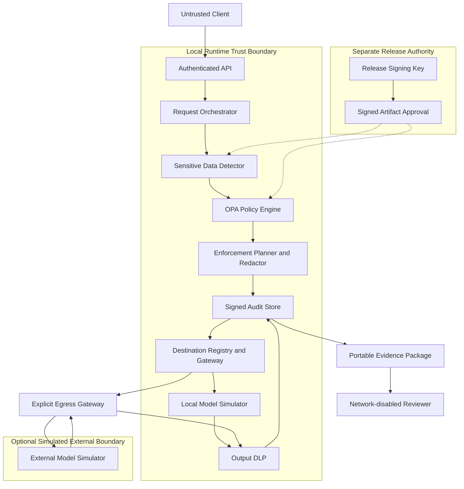
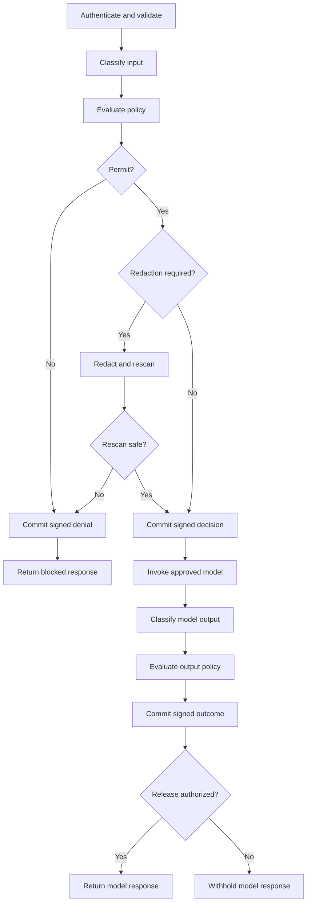

# System Design — Sovereign AI Control Plane

## 1. Problem statement

Organizations using AI systems need control over where sensitive information is processed, under which policies it may be disclosed, and whether those decisions can be independently examined afterward.

The proposed solution introduces a security control plane between AI consumers and model destinations.

Rather than trusting an AI model to enforce governance requirements, the control plane evaluates those requirements independently, before model execution and before releasing the model response.

### Design objectives

- Keep sensitive-data inspection inside the local trust boundary.
- Separate policy decisions from policy enforcement.
- Prevent direct routing to unapproved destinations.
- Fail closed when classification, policy or integrity checks are uncertain.
- Bind security decisions to identifiable policy and detector artifacts.
- Generate independently verifiable evidence without retaining raw sensitive content.

### Scope

The project demonstrates these objectives using a local model simulator and an optional simulated external destination.

Production cloud-provider integration, enterprise tenant isolation, hardware-backed trust and proof of geographic data residency are outside the current implementation scope.

## 2. System architecture

The application is implemented as a modular monolith with explicit domain contracts and replaceable infrastructure adapters.

OPA operates as a separate policy service. Model execution is isolated behind approved gateway interfaces, while evidence verification can run without access to the application or network.

## 3. Component responsibilities

| Component | Responsibility |
|---|---|
| API and ingress | Authentication, request validation, body-size limits, admission control and sanitized errors |
| Request orchestrator | Coordinates detection, decision, enforcement, model invocation, output inspection and auditing |
| Detector | Classifies input and output using local NLP, recognizers and normalized findings |
| OPA policy engine | Evaluates structured classification and request metadata against declarative rules |
| Enforcement planner | Validates destinations, policy obligations and execution ordering |
| Redactor | Removes detected sensitive spans and verifies the transformed payload |
| Model gateway | Routes only to registered destinations |
| Sovereign model simulator | Represents local model execution |
| Egress gateway | Mediates optional simulated external routing |
| External simulator | Represents an external execution boundary |
| Release manager | Verifies authorized policy and detector identities |
| Audit store | Persists signed decisions, outcomes and lifecycle evidence |
| Evidence reviewer | Verifies signatures, artifact integrity and eligible policy replays offline |

## 4. Trust boundaries and threat model

### Trust assumptions

The API client, prompt content and requested destination are untrusted.

Classification metadata is generated by the control plane rather than accepted as a trusted client assertion.

The host operating system, container runtime, deployed application, OPA executable, installed dependencies and local storage are within the current trusted computing base.

The release-signing private key is kept outside the runtime environment. Audit signing uses a separate authority managed locally by the deployment.

The optional external simulator resides on a separate private network. Access is mediated by the explicit egress gateway.

### Assets being protected

- Raw prompts and generated responses.
- Sensitive classification findings.
- Authorized policy and detector artifacts.
- Model destination configuration.
- Release and audit signing keys.
- Audit-chain integrity and historical evidence.
- Authenticated request identity.

### Threats and mitigations

| Threat | Implemented mitigation | Residual risk |
|---|---|---|
| Unauthorized API access | API-key authentication | No enterprise identity federation |
| Arbitrary destination or URL injection | Fixed destination registry and validated route obligations | Trusted host configuration can still be compromised |
| Prompt injection targeting governance decisions | Treat prompts as data; evaluate structured metadata in OPA | Downstream models remain susceptible to prompt injection |
| Sensitive data sent to an external model | Classification, policy denial or mandatory redaction and rescan | Detector false negatives remain possible |
| Sensitive information generated by a model | Response-side DLP and fail-closed release policy | Undetected sensitive content may still be released |
| Detector or OPA failure | Local fail-closed behavior | Availability may be reduced |
| Unauthorized policy or detector replacement | Artifact digests and signed release approval | No hardware-backed runtime attestation |
| Audit modification | Hash-linked events and Ed25519 signatures | Compromised local signing authority remains a risk |
| Audit-history truncation | External checkpoint verification when supplied | No automatic independent checkpoint witnessing |
| Resource exhaustion | Body deadlines, bounded admission and worker queues | Per-process controls rather than global rate limiting |
| Duplicate execution after retries | Durable opt-in idempotency | No exactly-once inference or automatic response recovery |

## 5. Sensitive-data detection

The detector uses Microsoft Presidio, the local spaCy English NLP model and custom recognizers.

Recognized categories include:

- Person names and locations.
- Email addresses and telephone numbers.
- Credit-card numbers, IBANs and US Social Security numbers.
- Supported API-credential and private-key patterns.

Classification results include category, character offsets, confidence, recognizer identity, coverage and classification status.

The main classification states are:

- `NO_PRIVATE_DETECTED`: no sensitive information was identified within the supported scope.
- `PRIVATE`: sensitive information was detected.
- `UNKNOWN`: the input could not be classified with sufficient assurance.

An absence of detected sensitive information is not proof that the text contains no private information.

The prototype primarily supports English ASCII text. Unsupported inputs and uncertain classifications are handled conservatively.

## 6. Policy decision and enforcement

OPA acts as the policy decision point. The application acts as the policy enforcement point.

The policy receives structured request and classification information rather than raw natural-language prompts.

A decision can include:

- `PERMIT` or `DENY`.
- Reason codes.
- Redaction obligations.
- An approved destination.
- Policy revision and content digest.

The application does not blindly execute policy responses. It validates the obligations, destination and required execution order before invoking the model.

### Request lifecycle

### Local routing

Eligible requests may be routed to the local sovereign-model simulator. Detected prohibited credentials, uncertain classification and unauthorized routing are denied.

### Simulated external routing

External routing is explicitly enabled and subject to additional policy constraints.

When redaction is required, sensitive spans are removed deterministically. The transformed prompt must pass a subsequent detection check before forwarding.

The caller cannot provide an arbitrary external URL.

## 7. Response-side DLP

An authorized input does not imply that the resulting model response is safe.

The generated response is intercepted and classified locally. The output policy evaluates whether the response may be released, must be blocked or may undergo an approved masking transformation.

Output masking is disabled by default and limited to supported categories when enabled.

If output classification or policy evaluation is uncertain, the response is withheld.

The outcome must be durably recorded before authorized model text is returned to the caller.

An HTTP 403 with `OUTPUT_BLOCKED` therefore represents a response-security decision, even when the model execution itself completed successfully.

## 8. Artifact integrity and release trust

Policy source, detector configuration and enumerated detector/model artifacts are associated with cryptographic digests.

An external release authority signs an approval identifying the authorized policy and detector tuple.

The approval contains an artifact identity, release generation, signer identity and predecessor reference where applicable.

The runtime verifies the installed artifacts against the approved release using a trusted public key. The private release-signing key is not required by the running application.

This design provides explicit artifact authorization and supports historical evidence replay.

It does not establish that every approved dependency is vulnerability-free or that an administrator cannot subvert the local runtime.

The submission bootstrap separately pins the published OCI container-image references. The signed policy/detector approval itself is not a signature over the complete container-image digest.

## 9. Audit and evidence generation

The audit system uses SQLite WAL storage, SHA-256 hash linking, HMAC fingerprints and Ed25519 signatures.

For admitted policy decisions, the system commits a signed `DECISION` event before model invocation.

A separate `OUTCOME` event records the subsequent execution and output-security result.

### Evidence content

Audit records can associate a request with:

- Authenticated principal and request identity.
- Classification metadata and recognizer identities.
- Policy decision and reason codes.
- Approved destination and transformation information.
- Policy, detector and release identities.
- Execution status.
- Output-DLP decision and response-release status.
- Cryptographic event hashes and signatures.

Raw prompt text, extracted sensitive values and raw model responses are not retained in normal audit metadata.

### Evidence verification

The portable evidence package contains a consistent audit snapshot and relevant verification artifacts.

The offline reviewer can verify:

1. Audit event signatures and hash-chain integrity.
2. Policy and detector artifact hashes.
3. Signed release approvals against trusted release keys.
4. Eligible recorded policy decisions through archived Rego replay.
5. Recorded outcome and output-release evidence consistency.

An independently trusted audit public key and checkpoint provide stronger authenticity and history-completeness assurances.

A self-contained evidence package alone establishes internal consistency, not independent proof of origin or completeness.

## 10. Failure handling and operational design

The request lifecycle deliberately distinguishes policy denial, successful model execution, blocked model output and unresolved execution failure.

If audit precommit fails, model execution is not started.

If execution times out or a later audit commit fails, the system cannot always determine whether the downstream operation occurred. It must not falsely claim that the operation was prevented.

The system includes bounded HTTP ingress, prompt admission and worker pools, default request-size limits, upload deadlines, dependency timeouts and durable opt-in idempotency.

Operational diagnostics expose process-local concurrency, DLP and latency information.

The architecture remains a single-host design with a local audit sequencer rather than a distributed, highly available service.

## 11. Design trade-offs

Security, privacy and verifiability were prioritized over broad integration and production-scale operation.

The modular monolith reduces deployment complexity. Local NLP avoids external inspection dependencies but limits classification coverage. Fail-closed behavior protects the trust boundary at the expense of availability. Local SQLite minimizes infrastructure requirements but constrains scalability.

Model simulators isolate control-plane behavior from LLM variability, but cannot establish real inference quality, provider security or geographic sovereignty.

Signed artifacts and evidence provide meaningful assurance under the declared trust assumptions, but increase release-management complexity.

These trade-offs are intentional within the project's scope.

## 12. Supporting material

For detailed implementation and operational information:

- [Architecture](architecture.md)
- [Threat Model](threat-model.md)
- [Detection Design](detection-design.md)
- [Policy Design](policy-design.md)
- [Response-side DLP](response-side-dlp.md)
- [Audit Design](audit-design.md)
- [Signed Release Workflow](signed-release-workflow.md)
- [Idempotency and Request Lifecycle](idempotency-and-request-lifecycle.md)
- [Evaluation Report](EVALUATION.md)