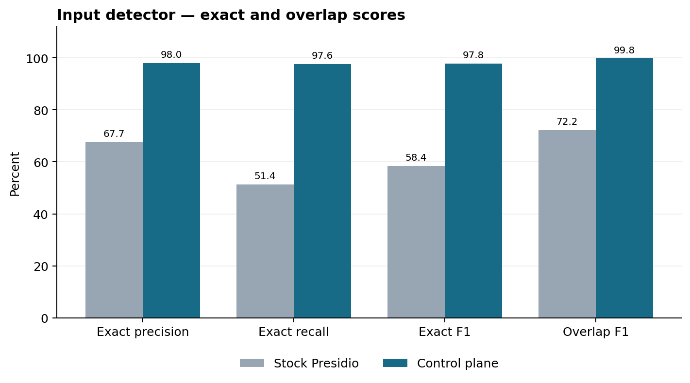
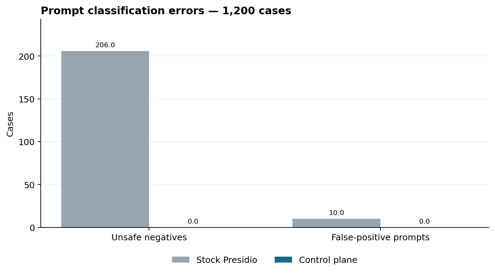
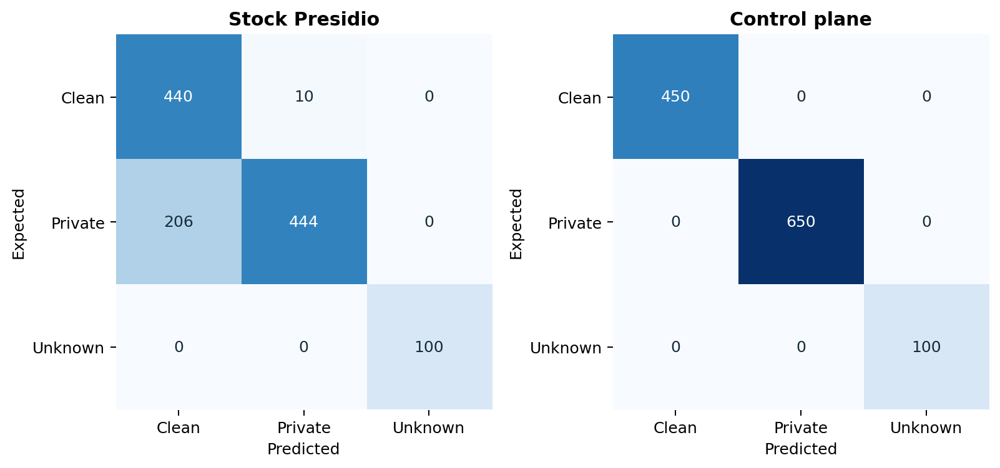
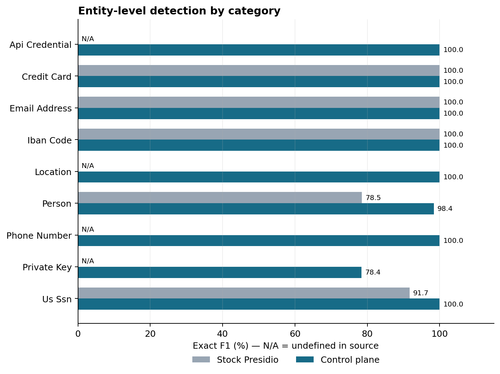
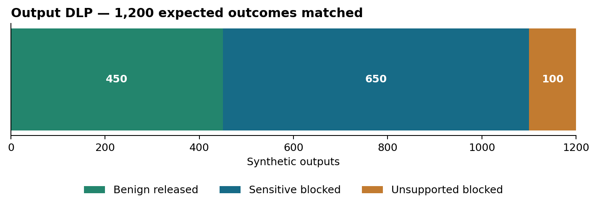
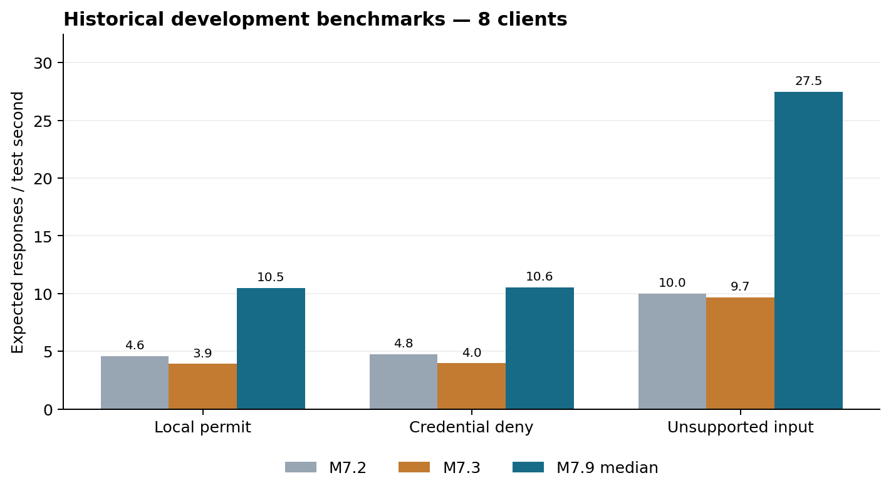
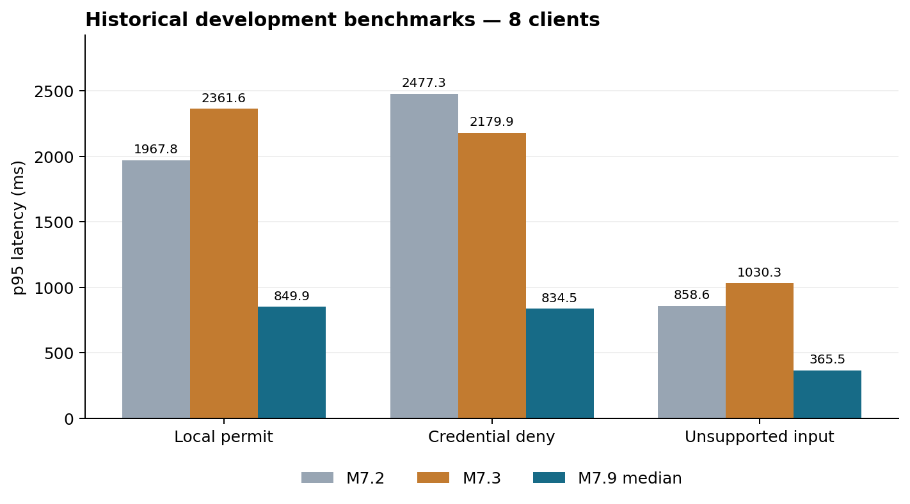
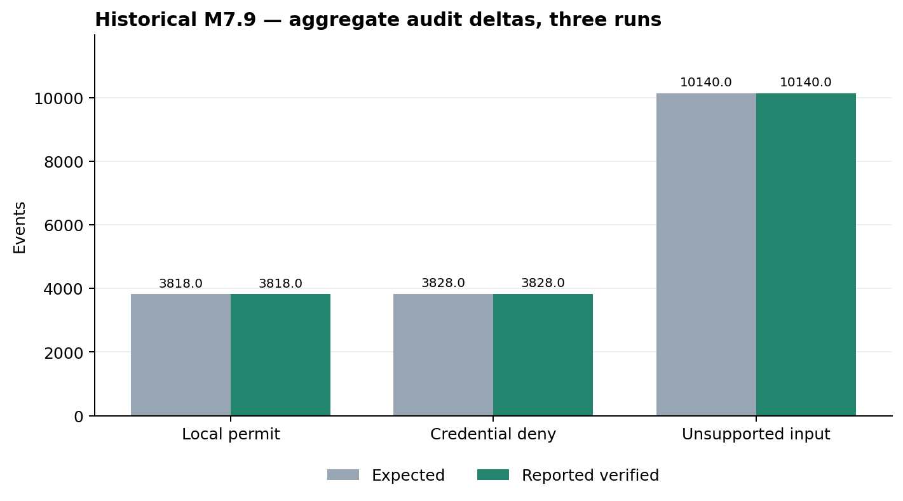
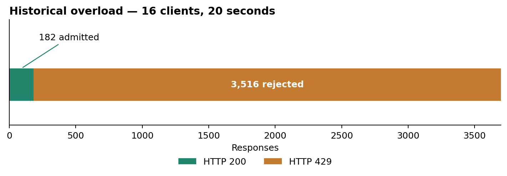

# Evaluation and performance report

**Evaluation date:** 21 November 2026 · **Application source:** `2905834c576fe3b0956a7a6091a545a6a5d4e50d`

This report assesses detection quality, policy enforcement, response-side data loss prevention (DLP), release integrity and operational performance. All workloads use synthetic data and simulated model destinations. The current source evaluations and release-verification logs are distinguished from historical development benchmarks; neither constitutes a production security certification.

## 1. Summary

| Measurement | Observed result |
|---|---:|
| Python regression suite | 607 passed, 4 skipped |
| Exact-span input F1 (stock → custom) | 58.42% → 97.81% |
| Unsafe-negative prompt classifications (stock → custom) | 206 → 0 |
| Actual OPA input enforcement replay | 1,200 cases; 0 unsafe simulated forwards; 0 reported issues |
| Full response-DLP evaluation | 1,200/1,200 expected outcomes |
| Sensitive output releases / false blocks | 0 / 0 on the frozen output dataset |
| Signed events verified in full output evaluation | 2,400 |
| Historical eight-client local-permit median goodput | 10.467 expected responses/s |

These results demonstrate the behavior of the tested fixtures, not perfect detection or production-scale availability. In particular, a separate live benchmark exposed response-DLP false positives on simulator-generated identifiers.

## 2. Environment, release and evidence scope

| Property | Recorded value |
|---|---|
| Host | Windows 11 Home, 64-bit, build 26300 |
| CPU | AMD Ryzen 9 9955HX, 16 cores / 32 logical processors |
| Host RAM | 31.18 GB |
| Podman | 5.8.1; WSL machine, 16 CPUs, 2 GiB memory, 100 GiB disk |
| Compose | Docker Compose 5.1.3 |
| Standalone Python | 3.14.4 |
| Standalone Presidio / spaCy / model | 2.2.366 / 3.8.18 / `en_core_web_sm` 3.8.0 |
| Active release verification | `RELEASE_VERIFIED`, generation 2 |
| Policy verification | `VERIFIED`, `redaction-response-dlp-v5` |
| API binding recorded | `127.0.0.1:8000` |

Recorded identities:

- Release ID: `daf666bf7e58ade915ac487b40cf08e30e2098b4969265b034805dabcb9f45f0`
- Policy digest: `e592df3e38e3c8e80b7742eda4ca154ea1f536b270431ef8134ce4fe30b53b2a`
- Approved detector digest: `9138f19b7dab51a2067002bab364914b0c620822708c8cc16d0a6e2795663c3d`
- Signer key ID: `d92f2efebce1430c862fd48edae002334bafa4ba10d5cc73726f32ab0c527b07`
- Application OCI reference digest: `sha256:c827e6a4cc768fa7e58aa670c22ea3da7a2e3f7a57721d84440c0e2ad762c0fa`
- OPA OCI reference digest: `sha256:12c31555a4d588d6975adc942ddcab2d3564871b48fcffb71336af14fbc10381`

The supplied logs show the generation-2 release and policy verification and five running services (control plane, OPA, sovereign model, egress gateway, external simulator). They do not by themselves prove independent trust-anchor provenance, live detector manifest verification or a complete offline replay of the operational audit history. The standalone detector runs have empty operational artifact digests: their source/configuration fingerprints and Git commit identify the evaluation code, not the deployed detector binary. Historical performance runs have separate commits and are not attributed to this release or host allocation.

## 3. Regression and static analysis

| Check | Result |
|---|---|
| `python -m pytest -q` | 607 passed, 4 skipped, 19.11 s |
| `python -m ruff check .` | All checks passed |
| `python -m ruff format --check .` | 218 files already formatted |
| `python -m mypy` | No issues in 155 source files |
| `python -m evaluation.cli validate` | Valid dataset, 1,200 cases |

The four skipped tests are not counted as passes; their reasons were not captured in the supplied log. No final-release Rego unit-test log or full CI scanner report is included in the supplied archives, so no additional test counts or scanner claims are made here.

## 4. Input detection evaluation

### Methodology

The validated `sovereign-synthetic-v1` dataset (version 1.0.0, SHA-256 `766980e0e02f92931dac747a36bcddf915d8ef597e267d9c552fce03a4c74109`) contains 1,200 labeled prompts: 350 standard sensitive, 250 clean, 200 hard negatives, 150 mixed entities, 150 adversarial and 100 unsupported. The development/validation/evaluation splits contain 240/240/720 cases respectively. The reported comparisons use **all splits**, not an independent untouched holdout estimate.

The stock adapter uses native Presidio built-in recognizers and a 0.5 threshold without the project's patterns or aggregation; it does not support API credentials or private keys in this configured taxonomy. Both adapters use the same dataset, versions and English ASCII scope, treating unsupported text as UNKNOWN. The comparison therefore measures the complete configured pipelines, not a controlled ablation of one recognizer.

Exact matching requires category and both offsets to agree; overlap matching requires a same-category intersection with one-to-one matching. Entity metrics cover 800 labeled in-scope entities; classification metrics measure the entire prompt separately.

### Overall results

| Metric | Stock Presidio | Control plane |
|---|---:|---:|
| Exact precision | 67.71% | 97.99% |
| Exact recall | 51.38% | 97.63% |
| Exact F1 | 58.42% | 97.81% |
| Exact TP / FP / FN | 411 / 196 / 389 | 781 / 16 / 19 |
| Overlap precision | 83.69% | 100.00% |
| Overlap recall | 63.50% | 99.63% |
| Overlap F1 | 72.21% | 99.81% |
| Overlap TP / FP / FN | 508 / 99 / 292 | 797 / 0 / 3 |
| Prompt status accuracy | 82.00% | 100.00% |
| Known-sensitive prompts classified clean | 206/650 (31.69%) | 0/650 (0%) |
| Clean prompts classified private | 10/450 (2.22%) | 0/450 (0%) |
| Unsupported prompts classified UNKNOWN | 100/100 | 100/100 |
| In-scope UNKNOWN / detector errors | 0 / 0 | 0 / 0 |
| Sequential detector p95 | 5.363 ms | 5.5354 ms |



The paired comparison found 363 changed cases, resolved all 206 stock unsafe-negative classifications and introduced no new ones. Exact F1 improved by 39.39 percentage points. The modest increase in sequential detector latency is not an end-to-end throughput measurement.





### Per-category results and residual errors

| Category | Stock exact F1 | Custom exact F1 | Custom exact TP / FP / FN |
|---|---:|---:|---:|
| API credential | N/A | 100% | 99 / 0 / 0 |
| Credit card | 100% | 100% | 91 / 0 / 0 |
| Email address | 100% | 100% | 101 / 0 / 0 |
| IBAN | 100% | 100% | 67 / 0 / 0 |
| Location | N/A | 100% | 86 / 0 / 0 |
| Person | 78.53% | 98.40% | 92 / 0 / 3 |
| Phone number | N/A | 100% | 96 / 0 / 0 |
| Private key | N/A | 78.38% | 58 / 16 / 16 |
| US SSN | 91.67% | 100% | 91 / 0 / 0 |

N/A preserves the source report's undefined F1 values; these stock categories had no exact true positives.



The diagnostics identify 16 partially covered private-key spans and three unmatched PERSON entities in prompts still classified PRIVATE. The former account for all 16 exact false positives and 16 of the 19 exact false negatives; the latter account for the remaining three misses. This explains why perfect prompt-status accuracy does not imply complete entity detection. Partial overlap does not prove safe redaction. The configured fail-closed policy and separate enforcement tests are needed to assess disclosure behavior.

## 5. Policy and enforcement evaluation

Controlled tests isolate orchestration and failure behavior. Full replay uses the actual standalone detector and an in-process simulated external destination, with either a fixture policy or a verified OPA snapshot. Neither mode invokes a real external provider or verifies a deployed signed release.

| Evaluation | Cases | Results |
|---|---:|---|
| Controlled, fixture policy | 21 | 21 passed, 0 failed |
| Real detector, fixture-policy replay | 1,200 | 579 completed, 621 blocked, 129 transformed, 0 unsafe forwards, 0 issues |
| Real detector, OPA CLI replay | 1,200 | 579 completed, 621 blocked, 129 transformed, 0 unsafe forwards, 0 issues |

Both replay reports record zero incomplete/unknown cases (as defined by the enforcement evaluator, not the detector's UNKNOWN classification count). Case-level rows confirm the counts and absence of recorded issues. The actual OPA replay uses the v5 policy digest recorded in section 2. Its outcomes match the fixture replay on this dataset; this is stronger evidence than fixture-policy tests alone, but not a general equivalence proof between the policies.

## 6. Response-side DLP and evidence

The standalone harness sends synthetic model outputs through the response inspection path and uses temporary audit signing keys. It separately exercises expected failure handling. The full dataset uses the real standalone Presidio detector and fixture policy; the actual OPA test uses controlled detector fixtures.

| Evaluation | Passed / cases | Released | Blocked | Errors | Unsafe sensitive releases | False blocks |
|---|---:|---:|---:|---:|---:|---:|
| Controlled, fixture policy | 15/15 | 2 | 11 | 2 | 0 | 0 |
| Full dataset, fixture policy | 1,200/1,200 | 450 | 750 | 0 | 0 | 0 |
| Controlled, actual OPA | 15/15 | 2 | 11 | 2 | 0 | 0 |

The two controlled error outcomes are expected test outcomes, not failed assertions. All five injected fault cases in each controlled run withheld output, with no unexpected release. The full dataset released all 450 benign outputs, withheld all 650 known-sensitive outputs and withheld all 100 unsupported outputs. Its exact entity F1 is 97.81%, the same as the input detector evaluation on these texts; the outcome gate nevertheless met every expected release/block decision.



| Evidence check | Controlled fixture | Full dataset fixture | Controlled OPA |
|---|---:|---:|---:|
| Signed events verified | 29 | 2,400 | 29 |
| Input policy decisions replayed | 15 | 1,200 | 15 |
| Output policy decisions replayed | 7 | 1,100 | 7 |
| Output local denials verified | 6 | 100 | 6 |
| Per-case evidence mismatches | 0 | 0 | 0 |

All three reports record `EVIDENCE_PACKAGE_VERIFIED`. Audit key and checkpoint were pinned for each evaluation run, but release signer trust was not externally established. These are reported verifier outcomes from isolated tests, not a new independent cryptographic verification of the original audit databases, proof of production release approval or external checkpoint witnessing. The full-dataset output policy replay is fixture-policy replay, not 1,100 actual OPA calls.

## 7. Historical runtime performance

### Scope and acceptance

The preserved `bench-results` archive contains successful development runs and unsuccessful experiments. This section includes only successful suites in the main measurements and labels them by development commit. The workloads are closed-loop HTTP tests, with scenarios executed sequentially, each for 60 seconds at eight concurrent clients. The benchmark's goodput is expected functional responses within the configured test window per second, including expected denials; it is not only HTTP 200 traffic. Values below are not final-release capacity claims.

Successful M7.2 (`db8945018760ed20afb2d4b53915f18ee9a9ad4e`) and M7.3 (`344a7c08517aa61a161a93c77db3d5702f328f7f`) suites each contain one repetition. M7.9 (`17a8f315ad5c782aaa7aa65639e2db4498eea277`) has three successful repetitions on 19 November 2026 UTC. Every selected scenario has a passing audit assertion, exact expected/actual audit delta and zero reported transport, functional or evidence-validation failures. The M7.9 diagnostic files additionally report zero poll errors, no process counter reset and no integrity issues. Historical suites report no separately pinned audit public key; their chain checks therefore do not establish independent origin or completeness. Raw logs were checked for consistency, not cryptographically reverified from an operational database.

### Goodput and latency across development iterations

| Scenario | M7.2 goodput/s | M7.3 goodput/s | M7.9 median goodput/s (range) |
|---|---:|---:|---:|
| Local permit | 4.583 | 3.900 | 10.467 (10.283–10.667) |
| Credential deny | 4.750 | 3.967 | 10.550 (10.367–10.583) |
| Unsupported input | 9.983 | 9.683 | 27.483 (27.100–29.517) |



| Scenario | M7.2 p95 ms | M7.3 p95 ms | M7.9 median p95 ms (range) |
|---|---:|---:|---:|
| Local permit | 1,967.80 | 2,361.61 | 849.92 (840.22–880.12) |
| Credential deny | 2,477.32 | 2,179.87 | 834.51 (833.62–845.03) |
| Unsupported input | 858.62 | 1,030.31 | 365.48 (302.63–367.77) |



The M7.3 results show a throughput decrease relative to M7.2; M7.9 subsequently shows materially higher goodput and lower p95 across all three paths. These are descriptive comparisons across commits, not a controlled proof of a specific optimization's effect. The report does not infer final-release scaling from historical measurements or assume historical resource allocations equal the current environment. No matched complete concurrency sweep or CPU/RAM time series was provided.

### Audit correctness and diagnostics

| Scenario | M7.9 requests (3 runs) | Expected audit events | Reported verified new events |
|---|---:|---:|---:|
| Local permit | 1,909 | 3,818 | 3,818 |
| Credential deny | 1,914 | 3,828 | 3,828 |
| Unsupported input | 5,070 | 10,140 | 10,140 |
| **Total** | **8,893** | **17,786** | **17,786** |



The preserved M7.9 diagnostics report maximum sampled rolling audit-queue p95 values of 29.0, 21.2 and 115.9 ms respectively. The unsupported-input path shows the largest audit wait despite its faster overall execution. Maximum observed rolling event-loop p95 is at most 1.9 ms across scenarios. These are maxima of sampled rolling windows, not whole-run component percentiles.

### Above-limit overload and evidence lookup

A separate successful 20-second local-permit development run used 16 clients at commit `c07729148d77d915b82bed75d01b73ecf000bd27`. Of 3,698 responses, 182 were admitted HTTP 200 responses and 3,516 were intentional HTTP 429 admission rejections (95.08%). The diagnostic admission counter also increased by 3,516; no other statuses were reported. All 364 expected new audit events were verified by the benchmark reviewer. Goodput was 8.65 expected responses/s in the test window. The aggregate p95 of 169.49 ms mixes admitted and fast-rejected responses and must not be compared directly to admitted-only latency.



The follow-up evidence lookup test recorded 48/48 verified queries at four-way concurrency with zero transient audit 503 responses, and 96/96 at eight-way concurrency with eight transient audit 503 responses resolved by retries. This demonstrates bounded resource protection and eventual successful lookup in the tested workload, not an unconditional availability guarantee.

### Excluded runs and final-release limitation

The archived `baseline-wal-retry` and `improved` suites both report credential-deny correctness/availability failures and are excluded from accepted performance aggregates. Incomplete runs are also excluded. The main historical comparison uses complete three-scenario suites rather than mixing in successful single-scenario retention/evidence checks of different durations.

In the separately reported clean-install baseline at commit `57247c5b`, three of 152 local-permit requests returned `OUTPUT_BLOCKED` (1.97%). The signed metadata and simulator format indicated that the named-entity recognizer had classified hexadecimal digest prefixes as PERSON or LOCATION. All 304 expected audit events matched. A subsequent smoke attempt at `2905834c` also failed its local-permit correctness gate; its exact failure reason was not confirmed in the supplied archives. These observations come from the earlier operator console/evidence discussion, not the three ZIP archives used for the primary analysis. They are not passing measurements. Application and policy behavior were preserved for submission rather than weakening the gate or introducing a benchmark exception. No successful final-release baseline or saturation profile is claimed.

## 8. Reproduction and source artifacts

Run from a repository-root developer environment with the project dependencies and pinned spaCy model installed. Use synthetic data only. Commands below use PowerShell; replace angle-bracket placeholders with actual paths.

```powershell
python -m pytest -q
python -m ruff check .
python -m ruff format --check .
python -m mypy
python -m tools.verify_policy_snapshot
python -m tools.verify_release
python -m evaluation.cli validate
python -m evaluation.cli detect --adapter control-plane --split all
python -m evaluation.cli detect --adapter presidio-stock --split all
python -m evaluation.cli compare --baseline <stock-run> --candidate <custom-run>
python -m evaluation.enforcement.cli --mode controlled
python -m evaluation.enforcement.cli --mode replay --split all
python -m evaluation.enforcement.cli --mode replay --split all --policy opa-cli --opa-bin <opa-executable> --policy-active .runtime/policy-active --policy-archive .runtime/policy-archive
python -m evaluation.output.cli --mode controlled
python -m evaluation.output.cli --mode dataset --split all
python -m evaluation.output.cli --mode controlled --policy opa-cli --opa-bin <opa-executable>
```

Actual OPA tests require a compatible verified executable. Historical benchmarks used the separate Git-ignored `benchmarks/` reviewer kit and a running approved deployment; the exact historical kit build is not included in the uploaded results. For current profiling instructions see [performance/README.md](../performance/README.md). Do not bypass correctness checks to reproduce a passing result. Retain the benchmark kit version and configuration with any future measurements.

Source evidence inventory (archives supplied separately, not embedded in this document):

| Archive | Relevant contents |
|---|---|
| `submission-results.zip` | Environment, dataset validation, policy/release verification and regression/static-analysis logs |
| `submission-20261121-215552.zip` | Custom/stock detector reports, comparison, diagnostics, enforcement and output runs with case-level rows |
| `bench-results.zip` | Development suite reports, scenario summaries and assertions, M7.9 diagnostics and overload follow-up |

The accompanying `evaluation-summary.json` contains aggregated metrics and archive SHA-256 checksums. Keep the raw archives private unless reviewed for sensitive metadata; do not distribute operational credentials or private signing keys. The figures are provided as PNG and SVG alongside this report.

## 9. Limitations and conclusions

The evaluation supports the implemented safety mechanisms within the tested scope: improved synthetic detector quality, fail-closed policy enforcement, response withholding when required, signed evidence generation and repeatable historical concurrency testing. The actual OPA replay closes an important gap left by fixture-only tests. The remaining entity-boundary errors and live simulator false positives justify further detector evaluation and representative workload testing.

The results do not establish perfect detection on unfamiliar data, safety for arbitrary real providers, production multi-tenant isolation, geographic residency, complete independently witnessed audit history or a performance SLO. The full dataset includes development data and cannot be treated as unseen generalization evidence. Historical performance is informative about engineering progress, not an acceptance measurement of the submitted release. Further work should prioritize held-out and representative detection testing, simulator workload robustness, independently anchored evidence and a reproducible final-release concurrency sweep using real resource measurements.
