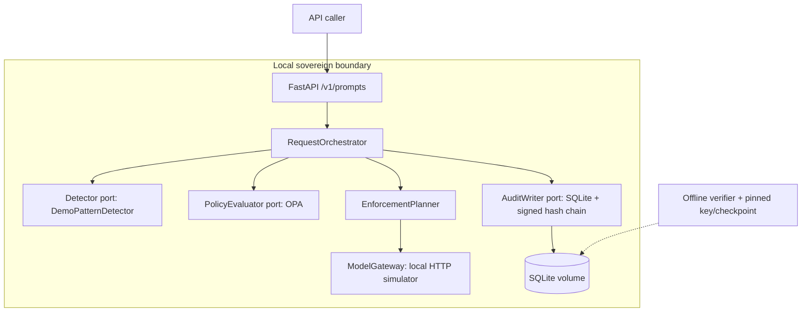
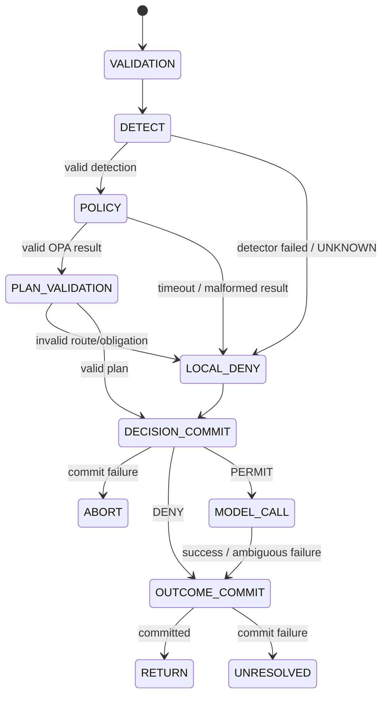

# Architecture and API / Domain Contracts (M1)

## Logical architecture



## Responsibilities and boundaries

- **Domain** (`app/domain/contracts.py`): frozen dataclasses and `Protocol` ports;
  no FastAPI, SQLite, or HTTP imports.
- **Ingress** (`app/api/`): HTTP request validation, key authentication, sanitized
  errors, and trusted principal injection. Caller can request a *destination ID*,
  not arbitrary URLs or an asserted geographic compliance status.
- **Application** (`app/application/orchestrator.py`): lifecycle ordering, safe
  fallback, and orchestration. No policy rules hardcoded except invariant fail-closed
  guardrails.
- **Detection** (`app/detection`): provisional pattern recognizers. M2 replaces it
  with Presidio and a pinned local spaCy model, retaining `DetectionResult`.
- **Policy** (`app/policy`): OPA's decision endpoint. Strict parse rejects absent
  `result`, unknown actions, or unrecognized fields.
- **Enforcement** (`app/enforcement`): validates the plan before any model call;
  does not evaluate policy itself. Initial registry permits only `sovereign-model`.
- **Audit** (`app/audit`): HMAC fingerprint, append chain, signed event receipts,
  and read-only verifier.

## Request state machine



No model call is made on `ABORT`. On `UNRESOLVED`, the decision event remains;
this may follow an actual model call, so the outcome cannot be called blocked.

## API contract

### `POST /v1/prompts`

Body (`application/json`):

```json
{"prompt":"Hello world", "destination_id":"sovereign-model", "purpose":"GENERAL"}
```

Authentication: `X-API-Key`. Principal is a fixed local-test identity for M1;
no tenant or role claims accepted from the request body. Prompts are limited to
8192 UTF-8 bytes and HTTP bodies to 16384 bytes.

Success response has `request_id`, `status`, `classification`, `decision`,
`decision_receipt`, `outcome_receipt`, `model_id`, and `output`.

A denial returns HTTP 403 with the same decision/evidence fields and no output.
Internal errors are sanitized. Raw prompt and matched entity values are not
returned in audit metadata.

### `GET /v1/requests/{request_id}`

Requires the API key and scopes the search to the authenticated tenant. Returns
recorded decision/outcome evidence; an absent outcome means the operation may
have been interrupted or the outcome persistence failed.

### `GET /health/live` and `/health/ready`

Liveness is process-only; readiness probes OPA's decision endpoint and model
health. For local test fixture mode, readiness reports `TEST_MODE`.

## Domain contracts

- `PromptCommand`: id, prompt, requested destination, purpose, trusted principal.
- `DetectionResult`: `PRIVATE | NO_PRIVATE_DETECTED | UNKNOWN`, sensitivity,
  findings, coverage, detector version, reason codes.
- `PolicyContext`: classification plus trusted caller/destination/purpose input;
  explicitly contains no raw prompt.
- `PolicyDecision`: `PERMIT | DENY`, ordered obligations, reason codes, revision.
- `ProcessedRequest`: status, classification, decision, receipts, optional model output.
- `AuditReceipt`: sequence, event hash, Ed25519 signature.

M1 obligations support only a single `ROUTE` on a permitted decision. The M2/M3
plan adds REDACT (including reclassification), external destination registry,
and additional transformation obligations.

## Migration path

Replace in-process detector with a separately scaled recognition service,
SQLite audit with a sequenced multi-writer service, local OPA with policy-bundle
sidecars, and Compose with Kubernetes. None of those replacements should change
the domain schemas. They **will** need new fault/latency and consistency designs.
